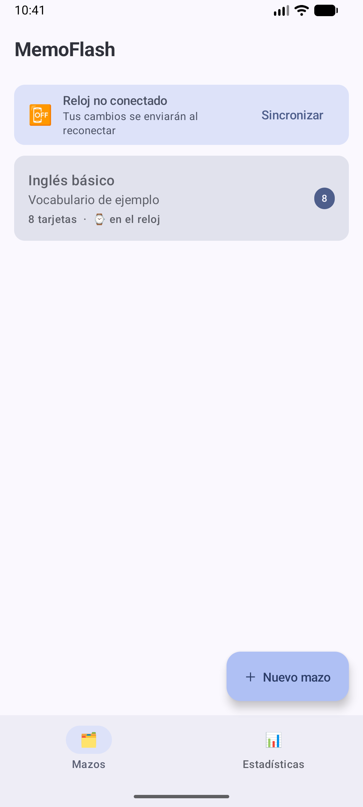
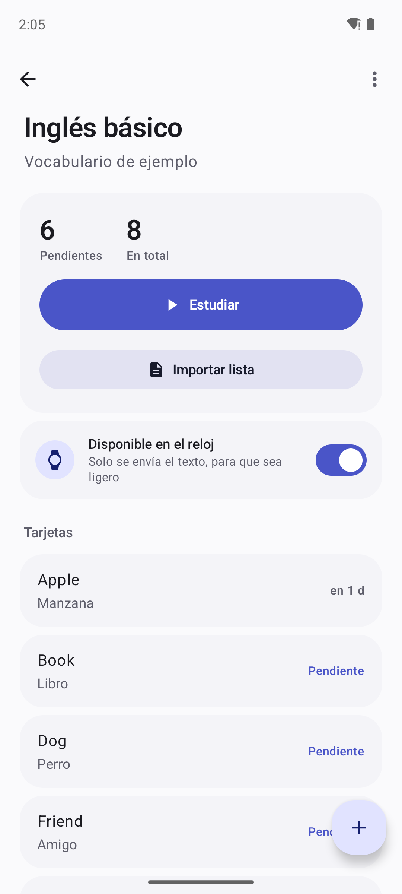
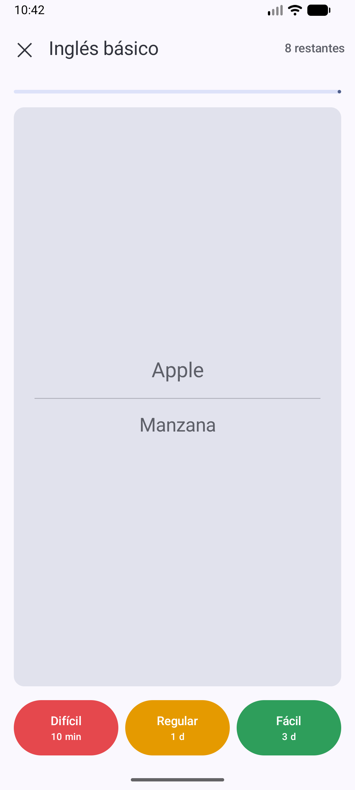
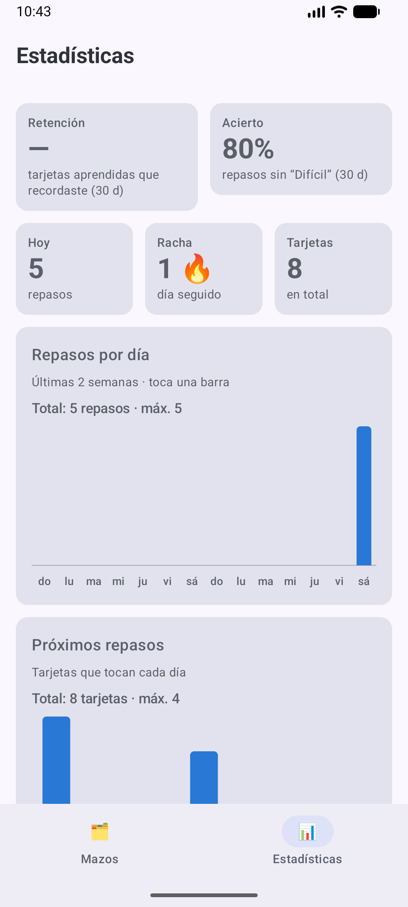
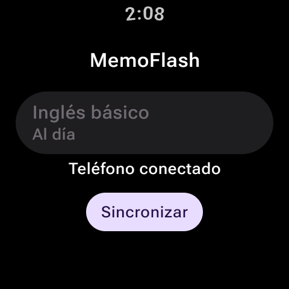

# MemoFlash

Asistente de estudio con flashcards y **repetición espaciada** para **Android (teléfono)** y **Wear OS (reloj)**.

**Versión 1.1** · Kotlin · Jetpack Compose · SQLite · Wearable Data Layer

- **Teléfono:** entras con correo y contraseña, creas y editas mazos (texto e imágenes), importas listas (pegar desde Excel/Sheets o abrir .txt/.csv), haces sesiones de estudio largas y ves estadísticas de retención. Los mazos, las tarjetas y los repasos se guardan en tu cuenta.
- **Reloj:** repasa sesiones cortas de 10 tarjetas: ves la pregunta, tocas para ver la respuesta y eliges **Difícil / Regular / Fácil**. Funciona sin el teléfono.
- **Juntos:** lo que estudias en un dispositivo actualiza las fechas de repaso en el otro. El teléfono es el que sube todo a la cuenta.

## Capturas

| Mazos | Detalle | Estudio | Estadísticas |
|:---:|:---:|:---:|:---:|
|  |  |  |  |

<p align="center"><br><em>Reloj conectado al teléfono</em></p>

## Diseño de la app del teléfono

La interfaz es minimalista: fondos claros (o oscuros, según el sistema), bloques planos con
esquinas redondeadas, una paleta índigo suave y **sin emojis**: todos los íconos son vectores de
Material Design.

| Pantalla | Qué tiene |
|---|---|
| **Acceso** | Correo y contraseña para entrar o crear la cuenta. |
| **Mazos** | Resumen "Para hoy", estado del reloj, la cuenta (correo y si ya se guardó en la nube) y la lista de mazos con su conteo de pendientes. |
| **Detalle del mazo** | Pendientes y total, botón **Estudiar**, **Importar lista**, interruptor "Disponible en el reloj" y la lista de tarjetas con cuándo toca cada una. |
| **Estudio** | Barra de progreso, tarjeta que **gira** para mostrar la respuesta y tres botones tonales (Difícil / Regular / Fácil) con el próximo intervalo. |
| **Editor** | Frente y reverso, cada uno con texto e imagen opcional. |
| **Estadísticas** | Retención, acierto, racha, repasos por día, pronóstico, estado de las tarjetas y repasos por dispositivo. |

### Transiciones

- **Entre pantallas:** al entrar, la nueva pantalla se desliza desde la derecha con un desvanecido;
  al volver atrás, el movimiento es el contrario. Entre las pestañas Mazos y Estadísticas hay un
  desvanecido cruzado con un leve zoom.
- **Estudio:** la tarjeta gira en 3D sobre su eje para mostrar la respuesta, la siguiente entra
  deslizándose y los botones de respuesta aparecen desde abajo.
- **Listas y datos:** los mazos y tarjetas se acomodan con animación al agregarse o borrarse, las
  barras de las gráficas crecen al abrir Estadísticas y los números cambian con un desvanecido.

## Arquitectura: offline-first con sincronización híbrida

```
┌──────────── Teléfono ────────────┐          ┌───────────── Reloj ─────────────┐
│  UI (Compose Material 3)         │          │  UI (Wear Compose Material 3)   │
│        │                         │          │        │                        │
│  BaseDatos (SQLite local)        │          │  BaseDatos (SQLite local)       │
│        │            │            │          │        │                        │
│        │            ▼            │          │        │                        │
│        │     Cuenta (Supabase)   │          │        │                        │
│        │     mazos, tarjetas,    │          │        │                        │
│        │     repasos             │          │        │                        │
│        │                         │          │        │                        │
│  Sincronizador ──► DataItem      │ Bluetooth│  Sincronizador ──► DataItem     │
│   /memoflash/telefono            │◄────────►│   /memoflash/reloj              │
│   (mazos + tarjetas + historial) │  Wi-Fi   │   (repasos hechos en el reloj)  │
└──────────────────────────────────┘          └─────────────────────────────────┘
```

Cada dispositivo tiene **su propia base SQLite** y se puede estudiar sin conexión. El teléfono y el
reloj se enlazan con la **Wearable Data Layer API** de Google Play Services: no hace falta internet
para ese enlace. Si los dispositivos están separados, los cambios se guardan y se entregan solos al
reconectarse.

La cuenta en la nube es aparte: el teléfono inicia sesión y sube o baja mazos, tarjetas y repasos.
Si no hay internet, el estudio sigue en el teléfono y se guarda en la cuenta cuando vuelve la red.
Las imágenes se quedan en el teléfono; en Supabase solo va el texto y el progreso.

### Cómo se evitan los conflictos

1. **El teléfono es el dueño del contenido.** Solo el teléfono crea/edita mazos y tarjetas; el
   reloj recibe una copia ligera (solo texto) de los mazos marcados “Disponible en el reloj”.
2. **El historial de repasos solo crece.** Cada repaso tiene un UUID; al sincronizar se unen los
   historiales de ambos dispositivos sin duplicados.
3. **La programación se recalcula del historial.** El algoritmo es una función pura: con el mismo
   historial siempre da el mismo `proximo_repaso`. Así, aunque estudies la misma tarjeta en el
   reloj y en el teléfono sin conexión, al unirse ambos llegan al mismo resultado.
4. El reloj marca sus repasos como confirmados cuando el teléfono se los devuelve en su paquete.
5. **La cuenta es el dueño de la copia en la nube.** Al entrar, el teléfono une lo local con lo de
   Supabase: gana la versión más nueva de cada mazo o tarjeta, y un borrado posterior a esa versión
   la elimina. El historial de repasos solo se suma. Cada fila lleva el usuario de la sesión y la
   base solo deja leer o escribir las filas propias (Row Level Security).

## Cuenta (Supabase)

El proyecto se llama **MemoFlash**. El esquema está en [`supabase/schema.sql`](supabase/schema.sql)
(tablas `mazos`, `tarjetas`, `historial_repasos` y `borrados`).

Al crear la cuenta, el correo queda confirmado enseguida para poder entrar sin abrir un enlace.
Cerrar sesión en el teléfono quita la copia local; los datos siguen en la cuenta.

## Base de datos (SQLite)

| Tabla | Columnas principales |
|---|---|
| `mazos` | `uuid`, `nombre`, `descripcion`, `en_reloj`, `actualizado` |
| `tarjetas` | `uuid`, `mazo_uuid`, `frente`, `reverso`, `imagen_frente`, `imagen_reverso`, **`nivel_dificultad`**, `intervalo_dias`, `repeticiones`, **`proximo_repaso`** |
| `historial_repasos` | `uuid`, `tarjeta_uuid`, `fecha`, `calificacion`, `intervalo_resultante`, `origen` (TELEFONO/RELOJ), `sincronizado` |

## Algoritmo de repetición espaciada (SM-2 con 3 botones)

`nivel_dificultad` es el factor de facilidad de SM-2 (empieza en 2.5, mínimo 1.3).

| Botón | Facilidad | Próximo repaso |
|---|---|---|
| Difícil | −0.20 | en 10 minutos (se reinicia la tarjeta) |
| Regular | −0.05 | 1 d → 3 d → intervalo × facilidad |
| Fácil | +0.15 | 3 d → 7 d → intervalo × facilidad × 1.3 |

## Estructura del proyecto

```
MemoFlash/
├── core/                       Lógica compartida
│   └── src/main/.../core/
│       ├── Modelos.kt, BaseDatos.kt, RepeticionEspaciada.kt
│       └── sync/               Sincronizador (Data Layer + puente local para emuladores)
├── mobile/                     App del teléfono
│   └── src/
│       ├── main/.../mobile/
│       │   ├── MainActivity.kt, MemoFlashApp.kt
│       │   ├── navegacion/     Pila de pantallas y transiciones
│       │   ├── tema/           Colores, tipografía, formas e íconos
│       │   ├── componentes/    Piezas de UI reutilizables (bloques, pastillas, diálogos)
│       │   ├── datos/          Consultas, imágenes, importador, formato y cálculo de estadísticas
│       │   ├── nube/           Sesión, subida y bajada de la cuenta
│       │   └── pantallas/      Acceso, mazos, detalle, editor, importar, estudio y estadísticas
│       ├── test/               Pruebas unitarias (importador, formato, estadísticas)
│       └── androidTest/        Pruebas de interfaz en emulador
├── wear/                       App del reloj
├── screenshots/                Capturas usadas en este README
├── supabase/schema.sql         Tablas y permisos de la cuenta
├── supabase.properties.example URL y clave publicable para compilar el teléfono
└── EMULADORES.md               Guía para correr los 2 emuladores
```

Las dos apps tienen el **mismo `applicationId`** (`com.ralenday.memoflash`) y deben firmarse con
la misma llave; es requisito de la Data Layer para que se reconozcan.

## Cómo correrla

> **¿Quieres correr el proyecto en otro PC con los 2 emuladores o descargar los APKs listos?**
> Consulta la [**Guía paso a paso para correr MemoFlash con 2 emuladores (EMULADORES.md)**](EMULADORES.md) o descarga los APKs directamente desde [**GitHub Releases**](https://github.com/Ralenday/MemoFlash/releases).

1. Copia la configuración de la cuenta (no se sube a git):

   ```bash
   cp supabase.properties.example supabase.properties
   ```

2. Abre la carpeta `MemoFlash` en Android Studio (**File → Open**) y espera el Gradle Sync.
3. Arriba, en el selector de configuración, elige **mobile** y córrela en el emulador de teléfono;
   luego elige **wear** y córrela en el emulador del reloj.

En el teléfono hay que entrar o crear una cuenta. La primera cuenta vacía recibe el mazo de
ejemplo (“Inglés básico”). El reloj no pide cuenta: recibe los mazos del teléfono.

### Sincronizar los 2 emuladores

Tienes dos maneras de conectar el emulador de teléfono y el de reloj (detalladas en [**EMULADORES.md**](EMULADORES.md)):

#### Opción rápida (puente local sin cuenta de Google)
Cuando corre en emuladores sin nodos de Wear OS emparejados, `Sincronizador` habilita automáticamente un puente local por TCP (`19876` para el teléfono y `19877` para el reloj). Solo necesitas redirigir los puertos por `adb`:

```bash
adb -s <emulador-telefono> forward tcp:19876 tcp:19876
adb -s <emulador-reloj> forward tcp:19877 tcp:19877
```

En emuladores con Android 17 (API 37) también hay que conceder el permiso de red local, una vez
instalada la app en cada uno:

```bash
adb -s <emulador> shell pm grant com.ralenday.memoflash android.permission.ACCESS_LOCAL_NETWORK
```

Al abrir MemoFlash en ambos (o tocar el ícono de sincronizar), el teléfono mostrará **“Reloj conectado: Reloj (emulador)”** y el reloj mostrará **“Teléfono conectado”**.

#### Opción con emparejamiento oficial de Wear OS (Data Layer)
Si prefieres emparejar los emuladores mediante Google Play Services:

1. En el emulador del teléfono (debe tener **Play Store**), abre Play Store, inicia sesión con una
   cuenta de Google e instala **Wear OS by Google** (o la app compañera de Pixel Watch).
2. En Android Studio: **Device Manager → ⋮ del emulador del reloj → Pair Wearable** y sigue el
   asistente (elige tu emulador de teléfono). Él solo abre la app compañera y conecta ambos.
3. Abre MemoFlash en ambos. En el teléfono la tarjeta de arriba debe decir **“Reloj conectado”**
   y en el reloj **“Teléfono conectado”**. Los mazos aparecerán en el reloj en unos segundos.

Prueba: repasa tarjetas en el reloj y abre **Estadísticas** en el teléfono: en “Dónde estudias”
verás los repasos hechos en el reloj.

## Pruebas

```bash
# Pruebas unitarias (no necesitan emulador)
./gradlew :core:testDebugUnitTest :mobile:testDebugUnitTest

# Pruebas de interfaz (con el emulador de teléfono encendido)
./gradlew :mobile:connectedDebugAndroidTest
```

| Prueba | Qué comprueba |
|---|---|
| `RepeticionEspaciadaTest` (core) | El algoritmo SM-2, incluido que el resultado no dependa del orden en que llegan los repasos de cada dispositivo. |
| `FusionNubeTest` (core) | La unión de la copia local con la de la cuenta: gana lo más nuevo y un borrado posterior elimina el mazo. |
| `ImportadorTest` | Separadores (tabulador, `;`, `-`, `=`, `,`), comillas de CSV, comentarios y líneas incompletas. |
| `FormatoTest` | Textos de "cuándo toca" y plurales. |
| `EstadisticasTest` | Racha, repasos de hoy, acierto, origen (teléfono/reloj), estados y pronóstico. |
| `FlujoPrincipalTest` (emulador) | Recorre la app: crea un mazo, agrega una tarjeta, la estudia, cambia de pestaña y borra el mazo. |

> Si Gradle dice que tu JDK no tiene `javac`, usa el que trae Android Studio:
> `./gradlew -Dorg.gradle.java.home=<ruta de Android Studio>/jbr ...`

Hecha con Kotlin, Jetpack Compose, SQLite, Supabase y la Wearable Data Layer API.
